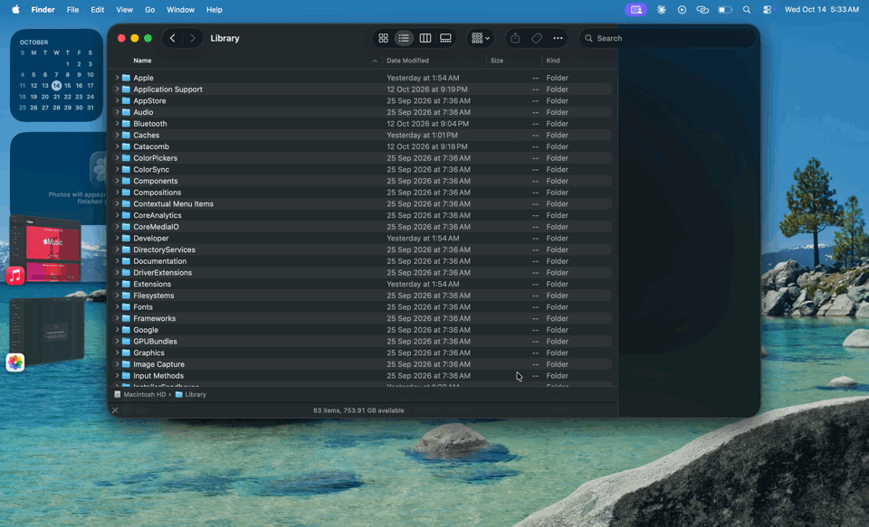

# Finder terminal panel (Finder + Ghostty)

KDE Dolphin's F4 terminal panel, rebuilt for macOS with the stock Finder and
[Ghostty](https://ghostty.org). One action tiles the front Finder window on the top
60 % of its display and a Ghostty window on the bottom 40 %, opened in Finder's
current folder. The shell follows Finder (folder navigation and tab switches) and
Finder follows the shell (`cd`). Run the action again to close the panel and put
Finder back where it was.



**Status:** works on the author's machine (macOS 26.7, Apple Silicon, Ghostty 1.3.1,
zsh, with and without Stage Manager). Nothing else has been tried. If it breaks on
your setup, open an issue with the output of `bin/finder-terminal status` and the
tail of `~/.local/state/finder-terminal/log`.

No dependencies: zsh, `osascript` (AppleScript and JavaScript for Automation), an
Automator Quick Action and a small AppleScript helper app built locally with
`osacompile`.

**Words used below.** The *panel* is the Ghostty window this tool opens under Finder.
*Toggle* means run the action: it opens the panel, or closes it if it is open.
*Stage Manager* is the macOS mode with the window strip on the left. *⌘-Tab* is the
app switcher. *Activating* an app means bringing it to the front by any means
(clicking one of its windows, its Dock icon, or ⌘-Tab).

## Requirements

- macOS 14 or later is the assumption; only macOS 26.7 has actually been tested.
- Ghostty 1.3 or later installed at `/Applications/Ghostty.app`. The launcher uses
  Ghostty's AppleScript dictionary, so `macos-applescript` must not be set to `false`
  in your Ghostty config.
- zsh as your login shell (the panel shell is whatever Ghostty's `command` is;
  the sync code is zsh-only).
- Optional: Xcode Command Line Tools (`xcode-select --install`) so `install.sh` can
  compile the event-driven watcher. Without them a slower polling watcher is used.

## Install

```bash
./install.sh
```

This does five things:

0. Compiles `src/finder-terminal-watch.swift` to `bin/finder-terminal-watch` if `swiftc`
   is available (skipped otherwise, see Fallback watcher below).
1. Builds the helper app `app/Finder Terminal.app` from `app/finder-terminal-applet.applescript`
   with `osacompile`. The Quick Action launches this app, and this app runs
   `bin/finder-terminal`. It exists only so macOS has a real app to grant
   Accessibility and Automation to: Quick Actions run inside Automator's hidden runner,
   which cannot be granted Accessibility, so without the helper the Ghostty window
   can't be placed and overlaps Finder.
2. Writes the Quick Action `~/Library/Services/Toggle Terminal Panel.workflow`
   (it points at the helper app in this folder, so don't move the folder; re-run
   `install.sh` if you do).
3. Asks before appending one line to `~/.zshrc` that sources `zsh/finder-follow.zsh`.
   The snippet is inert unless the shell was started with `FINDER_FOLLOW=1`.
4. Refreshes the Services registry.

Nothing is copied anywhere else. `./uninstall.sh` removes the Quick Action, the
`~/.zshrc` line, `~/.finder-follow` and `~/.local/state/finder-terminal`.

### Keyboard shortcut

Two Quick Actions are installed from the same workflow:

| Name | Where it shows up | Use |
|---|---|---|
| **Toggle Terminal Panel** | right-click a folder → Quick Actions | opens the panel in that folder |
| **Toggle Terminal Panel (Front Window)** | Finder › Services menu, keyboard shortcut | uses the front window's folder; needs no selection |

To bind a key: System Settings → Keyboard → Keyboard Shortcuts… → Services →
General → *Toggle Terminal Panel (Front Window)* → click "none", press the keys
(for example ⌃⌥T; F4 alone is usually taken by Spotlight). The shortcut works
whenever Finder is the active app. If an action is missing from the Quick Actions
submenu, enable it under Finder › Services › Services Settings… (or System Settings
→ General → Login Items & Extensions → Finder).

### Permissions macOS will ask for

The first toggle triggers prompts for **Finder Terminal** (the helper app). If you run
`bin/finder-terminal` by hand instead, the prompts name your terminal app. Allow each
one, then run the action again.

| Permission | Why |
|---|---|
| Automation → Finder | read the front window's folder, move/resize the window, set its folder from the shell |
| Automation → Ghostty | create, find, focus and close the panel window |
| Automation → System Events | place the Ghostty window (System Events does the Accessibility work) |
| Accessibility | required for System Events to move/resize windows. The launcher asks for it on first use; if the Ghostty window still isn't placed, open System Settings → Privacy & Security → Accessibility and turn on "Finder Terminal" (the helper shows a dialog with an "Open Settings" button in that case) |

The panel shell (Ghostty) also needs Automation → Finder the first time you `cd`.
To re-trigger a prompt you declined: `tccutil reset AppleEvents` (Automation) or
remove the app from the Accessibility list and run the action again.

## Use

- Toggle from Finder (Quick Action or shortcut). The Ghostty window gets focus.
- Navigate in Finder or switch Finder tabs → the shell `cd`s within about a second
  (only while the prompt is idle, never while a command is running).
- `cd` in the shell → the active Finder tab navigates there.
- `ff` prints the sync state. `ff off` pauses both directions and shows `⏸` in the
  prompt. `ff on` resumes and jumps to Finder's current folder.
- Close: toggle again, or just close the Ghostty window. Finder's previous bounds are
  restored either way.
- Only the shell started by the panel syncs (`FINDER_FOLLOW=1`). Other Ghostty
  windows, and tabs or splits you open inside the panel window, are untouched.

Command line: `bin/finder-terminal toggle|open|close|status [folder]`.

## Stage Manager

Stage Manager shows one app's windows at a time and parks the others in the side
strip, which would split Finder and the terminal. When Stage Manager is on (detected
from `com.apple.WindowManager GloballyEnabled`), the panel is made float-on-top via
Ghostty's `toggle_window_float_on_top` action. Floating windows are not managed by
Stage Manager, so:

- the panel stays docked under Finder, and clicking either window keeps both on
  stage with focus where you clicked;
- when you switch to a third app, the watcher drops the float so Stage Manager parks
  the panel in the strip with Ghostty; when Finder (or Ghostty) comes back in front
  the panel is floated and docked again. The watcher notices the app switch within
  50 ms, so the panel moves together with Finder.

Cross-app Stage Manager "sets" (drag a window out of the strip, or Shift-click it)
have no scripting API, so they are not used. Force the behaviour with
`FINDER_TERMINAL_FLOAT=on|off` (default `auto`).

## How it works

| Piece | File | Notes |
|---|---|---|
| Quick Action | `services/Toggle Terminal Panel.workflow` | Automator "Run Shell Script" → `finder-terminal toggle "$@"`. The folder-input entry passes the right-clicked folder; the no-input entry passes nothing and the script falls back to the front Finder window (then Finder's insertion location, then `$HOME`). |
| Launcher | `bin/finder-terminal` | Saves the front Finder window's id and bounds, picks the display under it (JXA `NSScreen.visibleFrame`, so the menu bar and Dock are excluded), sets Finder's bounds, creates the Ghostty window through Ghostty's AppleScript `new window with configuration` (initial working directory + environment variables, no second Ghostty instance), tiles it with System Events, starts the watcher. |
| Watcher | `src/finder-terminal-watch.swift` → `bin/finder-terminal-watch` | One small event-driven process per panel (pidfile), started by the launcher. It reacts to macOS app-activation events (float/park under Stage Manager), to Finder's Accessibility events (reads the active tab's folder only when Finder changed something; each Finder tab is its own `Finder window`, and the front one is the active tab), and to the panel window being destroyed (restores Finder at once). A 2 s safety timer re-checks everything. Talks to Finder and Ghostty with raw Apple events, no script engine. Writes `~/.finder-follow` atomically only when the folder changes and sends the panel shell SIGALRM so it `cd`s immediately; windows without a real folder (Recents, search results, AirDrop, Trash) are ignored. Measured: 14 MB resident, under 0.1 % CPU idle, ~0.1 s from a Finder click to the shell's `cd`. Built by `install.sh` with `swiftc` (Xcode or Command Line Tools). |
| Fallback watcher | `bin/finder-terminal-watch.js` | Used when `swiftc` is not installed. Same job in JavaScript for Automation, but polling: frontmost app every 50 ms, Finder every 0.5 s. About 27 MB and 4 % of one core while a panel is open. |
| Shell sync | `zsh/finder-follow.zsh` | `TMOUT=1` + `TRAPALRM` reads the file while the prompt is idle (the watcher also sends SIGALRM right after writing it, so this is usually immediate) and `cd`s + `zle reset-prompt`. A `chpwd` hook sets the front Finder window's target. Loop guards: the shell only reacts to *changes* of the file, ignores the file for 1.5 s after its own push, and skips pushing a `cd` it just performed on Finder's behalf. |

State lives in `~/.local/state/finder-terminal/` (`log`, `watcher.pid`,
`ghostty-window`, `finder-window`). `status` prints it.

## Tuning (environment variables)

| Variable | Default | Meaning |
|---|---|---|
| `FINDER_TERMINAL_SPLIT` | `0.6` | Finder's share of the screen height |
| `FINDER_TERMINAL_FLOAT` | `auto` | `on`/`off`/`auto`: float the panel above Stage Manager (auto = only when Stage Manager is enabled) |
| `FINDER_TERMINAL_GHOSTTY` | `/Applications/Ghostty.app` | Ghostty location |
| `FINDER_TERMINAL_STATE` | `~/.local/state/finder-terminal` | state directory |
| `FINDER_FOLLOW_FILE` | `~/.finder-follow` | path file shared by watcher and shell |
| `FINDER_FOLLOW_COOLDOWN` | `1.5` | seconds the shell ignores the file after pushing a `cd` to Finder |
| `FINDER_FOLLOW_INDICATOR` | `%F{yellow}⏸ %f` | prompt prefix while paused; set to empty to disable |
| `FINDER_FOLLOW_DEBUG` | unset | path of a file to log every pull/push |

The Quick Action runs in Automator's XPC runner with a minimal environment (your
shell's exports are not inherited), so to change `FINDER_TERMINAL_*` defaults edit the
top of `bin/finder-terminal`. The `FINDER_FOLLOW_*` ones are read by the panel shell
and can go in `~/.zshrc`.

## Known limits

- The paused indicator is prepended to `PROMPT` once at load. Prompt frameworks that
  rebuild `PROMPT` every command (starship, powerlevel10k) will drop it; use `ff` or
  `$FF_PAUSED` in your own prompt instead.
- Finder windows in full screen or macOS tiled layouts can't be resized by script.
- Under Stage Manager the panel is a floating window. If you have *other* Ghostty
  windows open and bring Ghostty to the front through the Dock icon or the ⌘-Tab app
  switcher (instead of clicking inside the panel), Stage Manager shows those other
  Ghostty windows and moves Finder into the strip. The panel itself stays where it
  is; click Finder's thumbnail in the strip to get Finder back.
- The panel is single-instance: toggling from a second Finder window re-focuses the
  existing panel.
- A `tmux` or nested `zsh` inside the panel inherits `FINDER_FOLLOW=1`, so every pane
  follows Finder and any pane can push to it.

## Later phases (not built)

- Phase 2: keep Ghostty docked under Finder when the Finder window moves or resizes
  (the watcher would track Finder's bounds and re-tile).
- Phase 3: a Finder Sync extension so the toggle also appears when right-clicking
  empty space.

## License

MIT, see [LICENSE](LICENSE).
