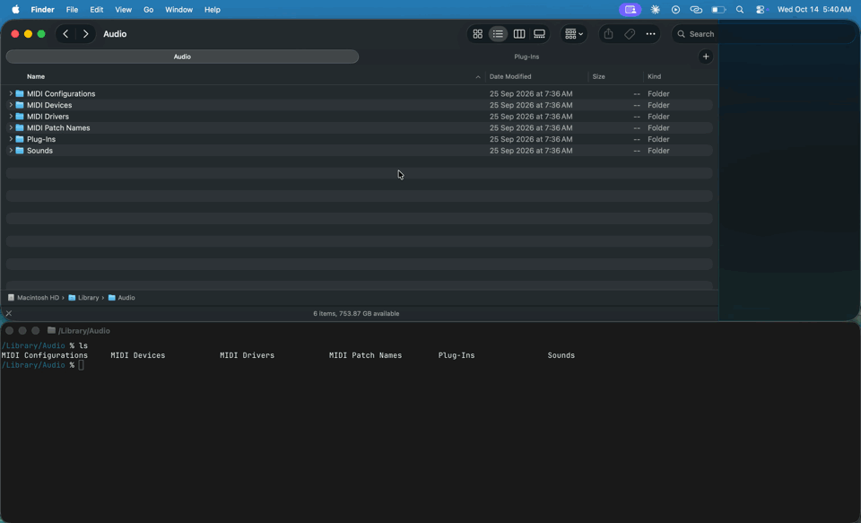

# Finder Terminal Panel

KDE Dolphin's integrated terminal (the F4 panel), for macOS Finder and
[Ghostty](https://ghostty.org). One toggle docks a terminal under Finder, and the two
follow each other as you move between folders.


*Right-click a folder → Quick Actions → Toggle Terminal Panel. Opening folders, going
back and switching Finder tabs moves the shell. `cd` in the shell moves Finder.
`ff off` pauses syncing and `ff on` resumes it.*

Opening a terminal "here" is easy. Keeping it in the folder you're browsing, and tiled
next to Finder, isn't. This does both.

## Features

- **One toggle.** Finder takes the top 60 % of the screen and the terminal the bottom 40 %.
  Toggle again to close the panel and put Finder back as it was.
- **Finder → terminal.** Open a folder, go back or up, or switch Finder tabs, and the
  shell follows. It never interrupts a running command.
- **Terminal → Finder.** `cd` anywhere and Finder goes there too.
- **Pause.** `ff off` stops syncing (⏸ shows in the prompt), `ff on` resumes.
- **Stage Manager aware.** Finder and the panel leave the stage and come back together.
- **Only the panel syncs.** Your other terminal windows are untouched.
- **Light.** Built from zsh, AppleScript and a tiny event-driven helper
  (about 14 MB, idle CPU near zero). Nothing runs while the panel is closed.



*With Stage Manager: switching to another app parks Finder and the panel together, and
clicking Finder brings both back.*

## Requirements

- macOS 14 or later (tested on macOS 26)
- [Ghostty](https://ghostty.org) 1.3 or later: `brew install --cask ghostty`
- zsh (the macOS default shell)
- Optional: Xcode Command Line Tools (`xcode-select --install`) for the low-overhead
  helper. Without them a simpler polling helper is used.

## Install

```bash
git clone https://github.com/hemkum/finder-terminal-panel ~/.finder-terminal-panel
```

```bash
~/.finder-terminal-panel/install.sh
```

The installer adds a Finder Quick Action and asks before adding one line to `~/.zshrc`.
Everything else stays in the cloned folder.

Then right-click any folder → **Quick Actions** → **Toggle Terminal Panel**. The first
run asks for permissions for **Finder Terminal**. Allow them all and run it again.

**Keyboard shortcut:** System Settings → Keyboard → Keyboard Shortcuts → Services →
General → **Toggle Terminal Panel (Front Window)**.

**Update:** `git -C ~/.finder-terminal-panel pull && ~/.finder-terminal-panel/install.sh`

**Uninstall:** `~/.finder-terminal-panel/uninstall.sh`, then delete the folder.

## Use

| Action | What it does |
|---|---|
| Toggle Terminal Panel | Open the panel in the right-clicked folder, or close it |
| Toggle Terminal Panel (Front Window) | Same, for the front Finder window (for the shortcut) |
| `ff` | Show sync status |
| `ff off` / `ff on` | Pause / resume syncing |

Closing the terminal window also restores Finder.

## Permissions

| Permission | Why |
|---|---|
| Automation → Finder | Read and set Finder's folder, size the window |
| Automation → Ghostty | Open, find and close the panel |
| Automation → System Events, Accessibility | Place the terminal window under Finder |

If the windows overlap after the first run, turn on **Finder Terminal** in System
Settings → Privacy & Security → Accessibility.

## Settings

Optional files:

- `~/.config/finder-terminal/config`: `FINDER_TERMINAL_SPLIT=0.5` sets Finder's share of
  the screen height (default 0.6). `FINDER_TERMINAL_FLOAT=on|off|auto` sets whether the
  panel floats above Stage Manager (default `auto`).
- `~/.config/finder-terminal/zshrc`: shell settings for the panel only, for example a
  compact prompt: `PROMPT='%F{cyan}%~%f %# '`

## How it works

- A Quick Action launches a small helper app, which runs `bin/finder-terminal`. The
  helper app exists so macOS has something to grant Accessibility to.
- `bin/finder-terminal` saves Finder's window size and opens a Ghostty window through
  Ghostty's AppleScript API (working directory plus `FINDER_FOLLOW=1`). It then tiles
  both windows.
- A watcher reacts to Finder's folder and tab changes and to app switches. It writes
  the folder to `~/.finder-follow` and nudges the panel shell.
- `zsh/finder-follow.zsh` runs only when `FINDER_FOLLOW=1`. It `cd`s when the file
  changes and the prompt is idle, and tells Finder about your own `cd`s. Guards stop
  the two sides from bouncing changes back and forth.

## Limits

- Only Ghostty and zsh are supported.
- Finder windows in full screen or in macOS window tiling can't be resized by script.
- With Stage Manager, opening the panel briefly moves Finder to the side strip for
  about half a second.

## License

[MIT](LICENSE)
